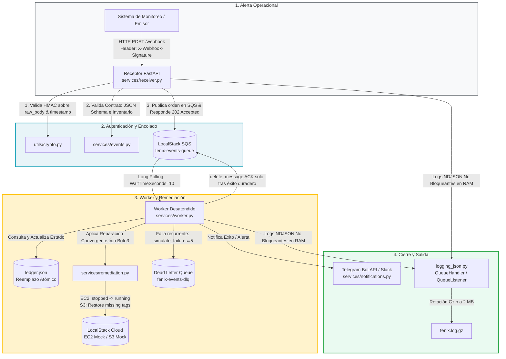

# 🦅 Proyecto Fénix: Sistema de Autorreparación de Infraestructura Cloud

Plataforma resiliente de remediación automática y convergente de infraestructura emulada en **AWS LocalStack** (`http://localhost:4566`), desarrollada en Python para la cátedra de **Programación para la Automatización II (PPA-2 / DEV6)**.

El sistema procesa alertas operacionales externas recibidas mediante **Webhooks HTTP autenticados con HMAC-SHA256**, desacopla la carga de trabajo en colas estándar de **AWS SQS** con política de reentrega a una **Dead Letter Queue (DLQ)**, y ejecuta un **Worker desatendido e idempotente** que remedia recursos cloud (EC2 y S3) usando **Boto3**, actualiza un registro de estado local atómico (`ledger.json`) y despacha notificaciones externas a **Telegram / Slack**.

[Video Defensa del Proyecto](https://ejemplo.com)

---

## 👥 Matriz de Roles y Responsabilidades del Equipo

| Integrante | Rol Técnico | Archivos / Módulos Asignados | Responsabilidad Principal |
| :--- | :--- | :--- | :--- |
| **Integrante 1** | Ingeniero de Entradas, Excepciones y Validación **Rafael Adán Cruz** | `src/fenix/utils/errors.py`<br>`src/fenix/utils/validation.py`<br>`src/fenix/services/events.py` | Jerarquía semántica `FenixError` (herencia estricta de `Exception`), validación regex de identificadores (`^[a-z0-9-]{3,32}$`), marcas ISO 8601 UTC y validación estricta del contrato JSON de eventos. |
| **Integrante 2** | Ingeniero de Mensajería e Inventario Cloud **Mauricio Jesús Goroso Romano** | `src/fenix/config/settings.py`<br>`src/fenix/services/sqs.py`<br>`src/fenix/services/demo.py` | Configuración segura de clientes Boto3 apuntando a LocalStack; creación de cola SQS y DLQ con `RedrivePolicy`; aprovisionamiento de infraestructura mock (`node-01` en EC2 y `bucket-01` en S3) y volcado de `inventory.json`. |
| **Integrante 3** | Ingeniero de Webhooks y Reparación Boto3 **Rodrigo Tarqui Gutierrez** | `src/fenix/utils/crypto.py`<br>`src/fenix/services/receiver.py`<br>`src/fenix/services/remediation.py` (`repair`) | Verificación y firma criptográfica HMAC-SHA256 sobre bytes crudos (`raw_body`) con `hmac.compare_digest()`; receptor FastAPI en `/webhook` (HTTP 202); función convergente de reparación de instancias EC2 y etiquetas S3. |
| **Integrante 4** | Ingeniero de Observabilidad y Comunicación **Javier Alejandro Quiroga** | `src/fenix/utils/logging_json.py`<br>`src/fenix/services/notifications.py` | Pipeline de logging NDJSON no bloqueante (`QueueHandler` y `QueueListener` en RAM) con rotación a 2 MB y compresión Gzip idempotente; conector externo de notificaciones (Telegram / Slack) con manejo de timeouts y backoff ante HTTP 429 (`Retry-After`). |
| **Integrante 5** | Coordinador de Integración y Worker Durable **Noemí Barragan** | `src/fenix/services/worker.py`<br>`src/fenix/services/remediation.py` (`handle`)<br>`src/fenix/cli.py`<br>`src/fenix/utils/state.py` | Bucle de consumo desacoplado con *Long Polling* SQS; actualización atómica del `ledger.json` por etapas; confirmación duradera del mensaje en SQS (`delete_message` / ACK) solo tras reparar y notificar exitosamente; orquestador de interfaz CLI con cumplimiento de PEP 765. |
| **Integrante 6** | Ingeniero de Diagnóstico, Pruebas y Caos **Ezequiel Nahuel Choque Martinez** | `tests/test_fenix.py`<br>`tests/demo/inject_fault.py` | Herramienta CLI de inyección de fallas en LocalStack (`inject_fault.py`); suite automatizada de pruebas forenses y de caos (firmas HMAC inválidas 401, cuerpos malformados 400, contrato inválido 422, fallas de red 503 y derivación a la DLQ con `simulate_failures=5`). |


---


## 📐 Diagrama de Arquitectura de la Solución




---

## 🛠️ Instalación y Configuración del Entorno

### 1. Clonar el Repositorio
```bash
git clone https://github.com/racoonar-Sla/proyecto_fenix.git
cd fenix_engine
```

### 2. Entorno Virtual Aislado (`.venv`)
* En Windows (PowerShell):
  ```powershell
  python -m venv .venv
  .venv\Scripts\Activate.ps1
  ```
* En Linux / macOS:
  ```bash
  python3 -m venv .venv
  source .venv/bin/activate
  ```

### 3. Instalar Dependencias y Modo Editable
```bash
pip install --upgrade pip
pip install -r requirements.txt
pip install -e .
```

### 4. Variables de Entorno
```powershell
Copy-Item .env.example .env
```

### 5. LocalStack con Docker
```bash
docker compose up -d
```
Verificar que los servicios requeridos (SQS, EC2 mock, S3) respondan en el puerto 4566.

---

# Documentación Técnica — Área 1: Entradas, Excepciones y Validación (Integrante 1)

**Responsable:** Rafael Adán Cruz  
**Rol:** Integrante 1 — Ingeniero de Entradas, Excepciones y Validación  
**Rama asignada:** `feature/i1-validacion` 


---

## Área 1 — Entradas, Excepciones y Validación de Esquema (Integrante 1 - Rafael Adán Cruz)

### 1. Responsabilidad y Alcance Técnico
El Área 1 constituye el **control de frontera de entrada** (*gatekeeper*) y sanitización sintáctica del Proyecto Fénix. Su responsabilidad es gobernar la jerarquía de excepciones de dominio, validar de forma estricta y determinista los tipos primitivos y marcas temporales, y hacer cumplir el contrato JSON cerrado de los eventos antes de que cualquier payload pueda interactuar con el bus de mensajería asíncrona en LocalStack SQS o con los motores de remediación.


### 2. Módulos Asignados
* `src/fenix/utils/errors.py`: Definición de la jerarquía semántica de excepciones de dominio del sistema:
  * `ProjectError` (alias `FenixError`): Clase base de la que derivan todos los errores del proyecto. Hereda estrictamente de `Exception` (nunca de `BaseException`) para preservar las señales de control del sistema operativo (`KeyboardInterrupt`, `SystemExit`).
  * `ValidationError`: Errores de sintaxis, formato, contrato de campos o tipos no conformes (asociado a HTTP 422 Unprocessable Entity).
  * `InventoryError`: Eventos dirigidos a recursos no registrados o incompatibles con el inventario del grupo.
  * `ConfigurationError`, `CommunicationError`, `TransientError`, `PermanentError`: Tipificación para control de reintentos y derivación a DLQ.
* `src/fenix/utils/validation.py`: Funciones puras de validación y normalización determinista:
  * `identifier(value)`: Valida identificadores mediante la expresión regular estricta `^[a-z0-9-]{3,32}$`. Conserva la entrada exacta sin aplicar recortes destructivos (`strip`).
  * `ttl_seconds(value)`: Valida el tiempo de vida en segundos dentro del rango operativo estricto [60, 600]. Rechaza explícitamente booleanos (`bool` como entero) y números decimales/flotantes (`float`), cumpliendo la directiva de la cátedra de no redondear entradas.
  * `utc_text(value)`: Valida marcas temporales ISO 8601 con desplazamiento estrictamente cero (`+00:00` o sufijo `Z`). Rechaza fechas naive o con husos horarios locales.
* `src/fenix/services/events.py`: Motor de validación de eventos de autorreparación:
  * `validate(event)`: Aplica el contrato JSON cerrado de exactamente 6 claves obligatorias (`schema_version`, `event_id`, `event_type`, `resource_id`, `occurred_at`, `simulate_failures`). Rechaza listas JSON en la raíz, valida la correspondencia de tipos y realiza la comprobación cruzada contra el inventario autorizado (`data/inventory.json`). Retorna una copia profunda inmutable (`copy.deepcopy`).
* `tests/test_contracts.py`: Suite oficial de pruebas unitarias parametrizadas para los contratos de frontera (`test_identifier_contract`, `test_ttl_contract`, `test_utc_contract`).

### 3. Comandos de Demostración y Verificación

#### A. Ejecución de la Suite de Contratos Automatizada
```powershell
# Ejecutar los contratos de validación de identificadores, TTL y UTC
python -m pytest tests/test_contracts.py -v

# Auditoría estática con Flake8 sobre los tres módulos asignados
flake8 src/fenix/utils/errors.py src/fenix/utils/validation.py src/fenix/services/events.py
```

#### B. Pruebas Interactivas en Terminal (1 Caso Válido y 3 Casos de Rechazo)
```powershell
# 1. Caso Válido: Evento canónico autorizado (node-01, instance.stopped, UTC)
python -c "from fenix.services.events import validate; e = {'schema_version': 1, 'event_id': 'evt-node-001', 'event_type': 'instance.stopped', 'resource_id': 'node-01', 'occurred_at': '2026-10-22T18:00:00Z', 'simulate_failures': 0}; res = validate(e); print('VALIDADO:', res['event_id'], '->', res['resource_id'])"

# 2. Rechazo 1: Lista JSON prohibida (se requiere dict único)
python -c "from fenix.services.events import validate; validate([{'schema_version': 1, 'event_id': 'evt-001'}])"

# 3. Rechazo 2: Inyección de clave no autorizada (contrato cerrado violado)
python -c "from fenix.services.events import validate; validate({'schema_version': 1, 'event_id': 'evt-node-001', 'event_type': 'instance.stopped', 'resource_id': 'node-01', 'occurred_at': '2026-10-22T18:00:00Z', 'simulate_failures': 0, 'campo_extra': 'invalido'})"

# 4. Rechazo 3: Recurso ajeno fuera del inventario autorizado
python -c "from fenix.services.events import validate; validate({'schema_version': 1, 'event_id': 'evt-node-999', 'event_type': 'instance.stopped', 'resource_id': 'node-99', 'occurred_at': '2026-10-22T18:00:00Z', 'simulate_failures': 0})"
```

#### C. Verificación de Aislamiento en LocalStack SQS
```bash
# Comprobar que tras los rechazos la cola permanece con cero mensajes
aws --endpoint-url=http://localhost:4566 sqs get-queue-attributes --queue-url http://localhost:4566/000000000000/fenix-grupo01-events --attribute-names ApproximateNumberOfMessages
```
---


## 4. Integrante 6 – Diagnóstico, Pruebas y Caos


### Responsabilidad


El Integrante 6 desarrolla herramientas y pruebas automatizadas para verificar la seguridad, la tolerancia a fallas y la capacidad de recuperación de Proyecto Fénix.


Su trabajo se concentra en dos objetivos:


- Provocar fallas controladas en recursos propios del laboratorio para comprobar los mecanismos de autorreparación.

- Verificar mediante pruebas automatizadas que el sistema valide eventos, proteja los recursos, procese mensajes correctamente y mantenga la trazabilidad de las operaciones.


### Archivos desarrollados


- `tests/demo/inject_fault.py`: herramienta CLI para inyectar fallas controladas en recursos EC2 y S3.

- `tests/demo/notify_stub.py`: simulador de notificaciones para probar errores temporales y permanentes sin llamadas de red.

- `tests/test_fenix.py`: pruebas de seguridad HMAC, validación de eventos y logs JSON.

- `tests/test_inject_fault.py`: pruebas unitarias de seguridad y comportamiento del inyector.

- `tests/test_scenarios.py`: pruebas de idempotencia, orden de confirmación ACK y redrive hacia DLQ.


### A. Herramienta de inyección de fallas


El módulo `tests/demo/inject_fault.py` permite provocar fallas controladas sobre recursos registrados en `data/inventory.json`.


La herramienta acepta exclusivamente estos alias:


- `node-01`: detiene una instancia EC2 propia cuando se encuentra en estado `running`.

- `bucket-01`: elimina la etiqueta `Owner` de un bucket S3 propio, conservando las demás etiquetas.


Antes de modificar un recurso, verifica:


1\. Que exista la variable de entorno `GROUP_ID`.

2\. Que el alias esté registrado en el inventario.

3\. Que el tipo y el identificador del recurso sean válidos.

4\. Que las etiquetas de propiedad correspondan al grupo configurado.

5\. Que el recurso se encuentre en un estado compatible con la operación.


La herramienta no acepta identificadores arbitrarios de AWS, no termina instancias, no elimina buckets y no borra colas.


También contempla la repetición segura: si la falla ya fue aplicada, informa `already_injected` y no vuelve a modificar el recurso.


### B. Ejecución de la herramienta


Desde la raíz del repositorio:


```powershell

# Consultar los argumentos disponibles

python -m tests.demo.inject_fault --help


# Inyectar una falla controlada en EC2

python -m tests.demo.inject_fault node-01


# Inyectar una falla controlada en S3

python -m tests.demo.inject_fault bucket-01

```


Requisitos previos:


- Tener el entorno virtual activado y las dependencias instaladas.

- Tener LocalStack iniciado y accesible.

- Haber generado los recursos de demostración y el inventario mediante el procedimiento de configuración del proyecto.

- Tener configurado `GROUP_ID` en el entorno o en el archivo `.env`.


### C. Pruebas de seguridad, validación y trazabilidad


El archivo `tests/test_fenix.py` contiene pruebas para distintos requisitos funcionales:


- **F04 – Autenticación HMAC:** rechaza firmas incorrectas, marcas de tiempo fuera de la ventana permitida y campos de firma duplicados. También comprueba el límite temporal de 300 segundos.

- **F05 – Integridad del mensaje:** verifica que la firma autentique los bytes originales del cuerpo HTTP. Un JSON con el mismo significado, pero con bytes diferentes, no debe considerarse el mismo mensaje firmado.

- **F07 – Validación del contrato:** acepta recursos incluidos en el inventario y rechaza recursos ajenos, campos adicionales y valores de tipo incorrecto.

- **F16 – Logs:** comprueba que los registros JSON mantengan campos de correlación y que la rotación genere archivos históricos comprimidos en formato `.gz`.


### D. Pruebas del inyector y simulación de notificaciones


El archivo `tests/test_inject_fault.py` utiliza clientes simulados (`FakeEC2` y `FakeS3`) para verificar las operaciones sin modificar recursos reales.


Se comprueban los siguientes escenarios:


- Detención de una instancia EC2 perteneciente al grupo.

- Repetición segura cuando la instancia ya está detenida.

- Rechazo de recursos cuyas etiquetas pertenecen a otro grupo.

- Eliminación exclusiva de la etiqueta `Owner` en S3.

- Conservación de etiquetas adicionales, como `Department`.

- Rechazo de alias que no existen en el inventario.


También se utiliza NotifyStub para simular respuestas de notificación:


- Error temporal 429, seguido de una respuesta exitosa.


- Error permanente sin realizar conexiones externas.


### E. Pruebas de idempotencia y procesamiento del worker


El archivo tests/test_scenarios.py verifica dos comportamientos fundamentales:


Idempotencia del procesamiento


Cuando se procesa dos veces el mismo evento, el ledger permite reconocer que ya fue atendido. La reparación y la notificación no deben ejecutarse nuevamente. La prueba comprueba que el estado final sea completed y que el registro conserve el número de intentos.


Orden de confirmación ACK


Se comprueba que el worker confirme el mensaje únicamente después de que el procesamiento finalice correctamente:


Si el handler falla, se solicita un reintento y no se ejecuta el ACK.


Si el handler termina correctamente, se ejecuta el ACK después del procesamiento.


Redrive hacia DLQ


Existe una prueba de integración identificada como test_redrive_with_localstack. Se encuentra omitida intencionalmente hasta completar la implementación de ensure_queues y retry_later, correspondientes al Integrante 2. Por lo tanto, no se considera una integración verificada.


### F. Comandos de ejecución de las pruebas


Ejecutar desde la raíz del repositorio con el entorno virtual activado:


# Pruebas de seguridad, contratos y logs

python -m pytest tests/test_fenix.py -v


# Pruebas del inyector y simulador de notificaciones

python -m pytest tests/test_inject_fault.py -v


# Pruebas de idempotencia, ACK y redrive

python -m pytest tests/test_scenarios.py -v


# Ejecutar toda la suite

python -m pytest -v


Las pruebas unitarias utilizan dependencias simuladas cuando corresponde, para verificar el comportamiento de forma controlada. Las pruebas de integración con LocalStack deben ejecutarse cuando estén disponibles todas las implementaciones y configuraciones necesarias.

# Documentación Técnica — Área 2: Mensajería SQS e Inventario Cloud (Integrante 2)

**Responsable:** Mauricio Jesús Goroso Romano  
**Rol:** Integrante 2 — Ingeniero de Mensajería e Inventario Cloud  
**Rama asignada:** `feat/i2-sqs-inventario`  

---

## Área 2 — Mensajería Asíncrona SQS e Infraestructura Demo (Integrante 2 - Mauricio Jesús Goroso Romano)

### 1. Responsabilidad y Alcance Técnico
El Área 2 provee la **columna vertebral de mensajería desacoplada y el entorno de infraestructura emulada** en LocalStack. Su responsabilidad abarca la configuración segura de clientes Boto3 hacia el endpoint local, la creación idempotente de colas estándar de AWS SQS con política de derivación a *Dead Letter Queue* (`RedrivePolicy`) y backoff exponencial basado en visibilidad, así como el aprovisionamiento convergente de recursos cloud (`node-01` en EC2 y `bucket-01` en S3), el volcado atómico del inventario (`data/inventory.json`) y la inyección controlada de fallas.

### 2. Módulos Asignados
- `src/fenix/config/settings.py`: Construcción centralizada y segura de clientes Boto3 (`client(service)`). Valida el formato del grupo (`grupoXX`), exige credenciales ficticias (`test`/`test`) y bloquea explícitamente cualquier `AWS_ENDPOINT_URL` que no apunte a `http://localhost:4566` o `http://127.0.0.1:4566`, evitando fugas accidentales hacia AWS real.
- `src/fenix/services/sqs.py`: Gestión del ciclo de vida de mensajería en colas estándar SQS:
  - `ensure_queues(prefix)`: Crea de forma idempotente primero la cola de mensajes fallidos (`{prefix}-dlq` con retención de 14 días / `1209600` s), obtiene dinámicamente su `QueueArn` y luego crea o actualiza la cola principal (`{prefix}-events`) con `VisibilityTimeout="45"`, `MessageRetentionPeriod="345600"` (4 días) y `RedrivePolicy` serializada con `maxReceiveCount="3"`.
  - `publish`, `receive`, `acknowledge`: Publicación JSON con atributo `EventId`, *Long Polling* (`WaitTimeSeconds=10`) solicitando `ApproximateReceiveCount`, y eliminación explícita mediante `ReceiptHandle`.
  - `retry_later(url, message)`: Implementa backoff exponencial acotado (`min(30, 2 ** count)`) ajustando `change_message_visibility` sobre la entrega actual sin duplicar mensajes ni reiniciar el contador de recepciones de la `RedrivePolicy`.
- `src/fenix/services/demo.py`: Aprovisionamiento convergente de infraestructura mock e inyección de fallas:
  - `setup_demo(inventory_path)`: Despliega de forma idempotente una instancia EC2 (`node-01`, tipo `t3.micro`) y un bucket S3 (`bucket-01`) etiquetados con `Project` y `Group` (reutilizando recursos existentes si ya fueron creados) y persiste de forma atómica el mapa resultante en `data/inventory.json`.
  - `fault(resource_id, inventory_path)`: Simula fallas reales sobre los recursos registrados en el inventario (detiene la instancia EC2 con `stop_instances` o elimina el etiquetado del bucket S3 con `delete_bucket_tagging`), lanzando `InventoryError` ante recursos desconocidos.
- `tests/test_i2_sqs_demo.py`: Suite de pruebas unitarias aisladas con `moto` que valida la creación idempotente de colas y `RedrivePolicy`, el cálculo y aplicación del backoff acotado en `retry_later`, la idempotencia de `setup_demo` y el comportamiento de `fault`.

### 3. Comandos de Demostración y Verificación

#### A. Ejecución de la Suite Unitaria y Auditoría Estática
```powershell
# Ejecutar pruebas unitarias del Área 2 con Moto (colas, DLQ, backoff, EC2/S3 y fallas)
python -m pytest tests/test_i2_sqs_demo.py -v

# Auditoría estática con Flake8 sobre los módulos del Área 2
flake8 src/fenix/config/settings.py src/fenix/services/sqs.py src/fenix/services/demo.py tests/test_i2_sqs_demo.py


