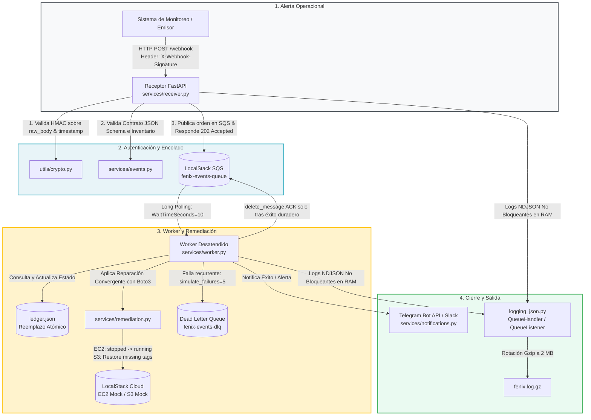
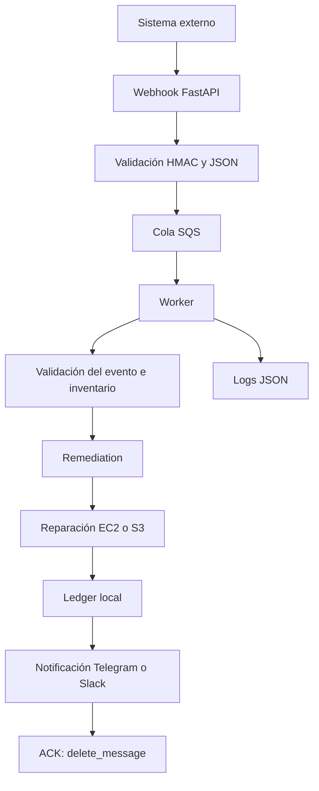

# 🦅 Proyecto Fénix: Sistema de Autorreparación de Infraestructura Cloud

## 1. Objetivo del sistema

Proyecto Fénix es un sistema desarrollado en Python para automatizar la detección y reparación de fallas en una infraestructura cloud emulada.

El sistema recibe eventos mediante Webhooks HTTP autenticados con HMAC-SHA256, los valida y los publica en colas de Amazon SQS. Luego, un Worker procesa los eventos, consulta el estado de los recursos y ejecuta las reparaciones necesarias utilizando Boto3.

El proyecto contempla dos recursos de laboratorio:

- **EC2:** una instancia detenida debe volver al estado `running`.
- **S3:** un bucket debe recuperar las etiquetas obligatorias.

Además, el sistema utiliza un registro local de estado (`ledger.json`) para guardar el progreso de cada evento y evitar repetir reparaciones o notificaciones que ya fueron completadas.

El entorno de integración previsto es AWS LocalStack. Para las pruebas locales también se utilizó Moto, una herramienta de Python que permite simular servicios de AWS.

## 2. Integrantes y responsabilidades

| Integrante | Rol | Archivos principales | Responsabilidad |
|---|---|---|---|
| Integrante 1 | Entradas, excepciones y validación | `errors.py`, `validation.py`, `events.py` | Validación de eventos y manejo de errores. |
| Integrante 2 | Mensajería e inventario Cloud | `settings.py`, `sqs.py`, `demo.py` | Configuración de clientes, colas SQS, DLQ e inventario. |
| Integrante 3 | Webhooks y reparación Boto3 | `crypto.py`, `receiver.py`, `remediation.py` (`repair`) | Autenticación HMAC, recepción HTTP y reparación de recursos. |
| Integrante 4 | Observabilidad y comunicación | `logging_json.py`, `notifications.py` | Registros JSON y envío de notificaciones. |
| Integrante 5 | Integración y Worker | `worker.py`, `remediation.py` (`handle`), `cli.py` | Procesamiento de mensajes, persistencia por etapas, ACK e interfaz CLI. |
| Integrante 6 | Diagnóstico y pruebas | `tests/`, `tests/demo/inject_fault.py` | Pruebas automatizadas e inyección de fallas. |

`src/fenix/utils/state.py` es un módulo de apoyo entregado para la lectura y escritura atómica del estado.

## 📐 Diagrama de Arquitectura de la Solución


## 3. Arquitectura general

El flujo principal del sistema es:



El receptor HTTP valida y publica el evento. La reparación no se realiza dentro de la petición HTTP: queda a cargo del Worker, que consume los mensajes de SQS.

## 4. Tecnologías utilizadas

- **Python 3.11 o superior:** lenguaje de programación.
- **Boto3:** SDK de Python para interactuar con servicios AWS.
- **AWS LocalStack:** emulación local de servicios AWS para la integración.
- **Moto:** simulación de servicios AWS durante pruebas locales.
- **FastAPI:** receptor de Webhooks HTTP.
- **HMAC-SHA256:** autenticación e integridad de los Webhooks.
- **Amazon SQS:** cola de mensajes.
- **Dead Letter Queue (DLQ):** aislamiento de mensajes que no pudieron procesarse.
- **Pytest:** ejecución de pruebas automatizadas.
- **Docker Desktop:** ejecución del entorno LocalStack.

## 5. Requisitos previos

- Windows, Linux o macOS.
- Python 3.11 o superior.
- Git.
- Visual Studio Code u otro editor.
- Dependencias declaradas en `requirements.txt` y `requirements-lock.txt`.
- Docker Desktop y LocalStack para las pruebas de integración reales.

El proyecto no debe ejecutarse contra una cuenta real de AWS. Las credenciales de laboratorio son ficticias y el endpoint debe apuntar a LocalStack.

## 6. Instalación desde cero

### 6.1. Clonar el repositorio

```bash
git clone https://github.com/racoonar-Sla/proyecto_fenix.git
cd proyecto_fenix
```

### 6.2. Crear el entorno virtual

En Windows PowerShell:

```powershell
python -m venv .venv
.venv\Scripts\Activate.ps1
```

En Linux o macOS:

```bash
python3 -m venv .venv
source .venv/bin/activate
```

### 6.3. Instalar las dependencias

Para instalar las dependencias del proyecto:

```bash
python -m pip install --upgrade pip
python -m pip install -r requirements.txt
python -m pip install -e .
```

Para reproducir las versiones registradas en el archivo de bloqueo:

```bash
python -m pip install -r requirements-lock.txt
```

### 6.4. Configurar las variables de entorno

En Windows PowerShell:

```powershell
Copy-Item .env.example .env
```

Generar una clave segura para el Webhook:

```powershell
python -c "import secrets; print(secrets.token_urlsafe(32))"
```

Copiar el resultado en `WEBHOOK_SECRET` dentro del archivo `.env`.

Completar los datos del proveedor de notificaciones elegido únicamente si se va a utilizar Telegram o Slack.

**Importante:** el archivo `.env` contiene datos privados y no debe subirse al repositorio. Se debe utilizar `.env.example` como plantilla.

### 6.5. Configurar LocalStack

Con Docker Desktop iniciado y el archivo de configuración correspondiente:

```bash
docker compose up -d
```

La dirección local prevista es:

```text
http://localhost:4566
```

La integración real requiere verificar que los servicios necesarios respondan correctamente.

## 7. Variables de entorno

| Variable | Descripción |
|---|---|
| `AWS_ENDPOINT_URL` | Dirección del endpoint de LocalStack. |
| `AWS_ACCESS_KEY_ID` | Credencial ficticia de laboratorio. |
| `AWS_SECRET_ACCESS_KEY` | Clave ficticia de laboratorio. |
| `AWS_DEFAULT_REGION` | Región de AWS utilizada por el proyecto. |
| `GROUP_ID` | Identificador del grupo. |
| `PROJECT` | Nombre del proyecto. |
| `QUEUE_PREFIX` | Prefijo de las colas SQS. |
| `SQS_QUEUE_NAME` | Nombre de la cola principal. |
| `SQS_DLQ_NAME` | Nombre de la Dead Letter Queue. |
| `WEBHOOK_SECRET` | Clave para la autenticación HMAC. |
| `WEBHOOK_PORT` | Puerto del receptor HTTP. |
| `NOTIFY_PROVIDER` | Proveedor de notificaciones: console, telegram o slack. |
| `TELEGRAM_BOT_TOKEN` | Token del bot de Telegram. |
| `TELEGRAM_CHAT_ID` | Identificador del chat de Telegram. |
| `SLACK_WEBHOOK_URL` | Dirección del webhook de Slack. |

Los valores reales de los secretos deben configurarse localmente y nunca publicarse en GitHub.

## 8. Contrato del evento

El sistema utiliza eventos JSON con los siguientes campos obligatorios:

```json
{
  "schema_version": 1,
  "event_id": "evt-node-001",
  "event_type": "instance.stopped",
  "resource_id": "node-01",
  "occurred_at": "2026-10-22T18:00:00Z",
  "simulate_failures": 0
}
```

Los tipos de eventos previstos son:

- `instance.stopped`: indica que una instancia EC2 está detenida.
- `bucket.tags_missing`: indica que un bucket S3 perdió etiquetas obligatorias.

El identificador del recurso debe corresponder a un alias conocido en el inventario del laboratorio. No se deben aceptar identificadores arbitrarios de recursos externos.

## 9. Interfaz de línea de comandos (CLI)

La interfaz se encuentra en:

`src/fenix/cli.py`

Se implementa utilizando `argparse`, que permite organizar la ejecución mediante subcomandos.

Los comandos definidos son:

| Comando | Función |
|---|---|
| `init-queues` | Inicializa las colas SQS. |
| `setup-demo` | Prepara el entorno de demostración. |
| `fault <resource_id>` | Solicita una falla en un recurso. |
| `worker` | Inicia el Worker. |
| `worker --once` | Realiza una consulta y finaliza. |
| `send <event_file>` | Lee un evento JSON, lo valida y lo publica en SQS. |

Ejemplos:

```bash
python -m fenix.cli init-queues
python -m fenix.cli setup-demo
python -m fenix.cli fault node-01
python -m fenix.cli worker
python -m fenix.cli worker --once
python -m fenix.cli send examples/node-event.json
```

**Nota:** los comandos `setup-demo` y `fault` dependen de las implementaciones del módulo de demostración. Si todavía presentan `NotImplementedError` o indican que están pendientes, no deben considerarse operativos.

## 10. Worker y procesamiento de mensajes

El Worker es el componente encargado de consumir y procesar los eventos almacenados en SQS.

Su funcionamiento general es:

1. Consultar la cola mediante long polling.
2. Recibir el mensaje y leer su contenido JSON.
3. Validar nuevamente el evento y sus recursos.
4. Consultar el registro local para recuperar el progreso anterior.
5. Ejecutar la reparación si todavía no fue completada.
6. Guardar el resultado de la reparación.
7. Enviar la notificación si todavía está pendiente.
8. Guardar el estado de la notificación.
9. Confirmar el mensaje mediante `delete_message` solamente después de completar el procesamiento requerido.

El archivo principal es:

`src/fenix/services/worker.py`

El procesamiento por etapas se coordina desde:

`src/fenix/services/remediation.py`

### 10.1. Persistencia e idempotencia

El registro local conserva información asociada al `event_id`, incluyendo:

- `attempts`
- `repair_done`
- `repair_result`
- `notified`
- `status`

Esto permite recuperar el trabajo cuando ocurre una interrupción.

Por ejemplo, si la reparación ya se completó pero la notificación falló, el Worker debe recuperar el estado pendiente y volver a intentar la notificación sin repetir una reparación que ya fue confirmada.

La persistencia local ayuda a evitar efectos repetidos, pero no convierte las operaciones externas y el archivo JSON en una única transacción. Por eso no se promete una entrega exactamente una vez.

### 10.2. ACK y reintentos

El ACK se realiza con `delete_message` utilizando el `ReceiptHandle` correspondiente a la recepción actual.

Si el procesamiento falla, el mensaje debe conservarse para permitir un nuevo intento. La política `RedrivePolicy` de SQS es la encargada de derivar los mensajes persistentes a la DLQ cuando se supera el límite de recepciones configurado.

No se debe publicar un mensaje nuevo para simular un reintento ni eliminar un mensaje fallido para ocultar el error.

## 11. Pruebas realizadas

Las siguientes pruebas se ejecutaron durante el desarrollo local del proyecto.

| Prueba | Comando o procedimiento | Resultado observado |
|---|---|---|
| Reanudación después de una falla de notificación | `python prueba_reanudacion.py` | Aprobada con mocks. La reparación se ejecutó una vez y luego se completó la notificación pendiente. |
| Publicación, recepción y ACK con Moto | `python test_moto_fenix.py` | Aprobada. Se confirmó la publicación, recepción y eliminación del mensaje en el entorno simulado. |
| Pruebas automáticas seleccionadas | `python -m pytest -m "not pendiente and not integracion" -v` | 5 aprobadas y 7 excluidas por los marcadores. |

### 11.1. Detalle de las pruebas automáticas

Resultado observado:

```text
5 passed, 7 deselected
```

Pruebas aprobadas:

- `test_moto_fenix.py::test_sqs_with_moto`
- `tests/test_base.py::test_state_survives_restart`
- `tests/test_base.py::test_corrupt_state_is_not_empty`
- `tests/test_base.py::test_delay_is_bounded`
- `tests/test_base.py::test_json_log_context`

Las siete pruebas excluidas no deben considerarse aprobadas. Se excluyeron por utilizar los marcadores `pendiente` o `integracion`.

### 11.2. Alcance de las pruebas

Moto permite simular servicios de AWS para probar el código localmente. Sin embargo, sus resultados no sustituyen una prueba de integración real con LocalStack.

Las pruebas de reanudación realizadas con mocks demuestran el comportamiento del código bajo esas condiciones controladas, pero no demuestran por sí solas una interrupción real de SQS o una derivación efectiva a la DLQ.

## 12. Matriz de pruebas pendientes de integración

La siguiente tabla identifica pruebas de la consigna que todavía requieren evidencia específica.

| ID | Caso | Estado de evidencia |
|---|---|---|
| F01 | Inicializar colas y preparar el laboratorio dos veces sin duplicados | Pendiente de integración LocalStack. |
| F02 | Reparar una instancia detenida y verificar su estado mediante Boto3 | Pendiente de integración LocalStack. |
| F03 | Recuperar etiquetas obligatorias de un bucket S3 | Pendiente de integración LocalStack. |
| F04 | Rechazar firmas ausentes, alteradas o vencidas | Pendiente de evidencia específica. |
| F05 | Rechazar HMAC inválida con bytes diferentes | Pendiente de evidencia específica. |
| F06 | Rechazar JSON roto y contrato incorrecto | Pendiente de evidencia específica. |
| F07 | Rechazar alias ajeno y claves extra | Pendiente de evidencia específica. |
| F08 | Enviar JSON corrupto directamente a SQS y verificar su tratamiento | Pendiente de integración LocalStack. |
| F09 | Simular fallas temporales y verificar la recuperación | Pendiente de evidencia completa. |
| F10 | Verificar la derivación de un mensaje persistente a la DLQ | Pendiente de integración LocalStack. |
| F11 | Repetir un evento completo y reiniciar el Worker | Pendiente de evidencia completa. |
| F12 | Interrumpir después de reparar y antes de notificar | Reanudación simulada aprobada; falta evidencia de integración real. |
| F13 | Verificar el comportamiento cuando SQS no está disponible | Pendiente de integración LocalStack. |
| F14 | Simular fallas 429 o timeout de notificación | Pendiente de evidencia específica. |
| F15 | Cambiar el contenido manteniendo el mismo `event_id` | Pendiente de evidencia específica. |
| F16 | Verificar rotación, compresión Gzip y contenido de los logs | Pendiente de evidencia específica. |

## 13. Limitaciones conocidas

Durante las pruebas locales se presentaron dificultades para iniciar Docker y conectar con LocalStack en el endpoint `http://localhost:4566`.

Por las limitaciones del equipo utilizado, se continuó con pruebas locales mediante Moto y mocks.

Esto permitió comprobar partes del procesamiento de mensajes, la persistencia y la reanudación, pero no reemplaza las pruebas de integración exigidas por la consigna.

Quedan pendientes de completar o demostrar:

- Integración real con LocalStack.
- Creación y verificación de recursos EC2 y S3 mediante Boto3.
- Funcionamiento real de SQS y su DLQ.
- Envío real de una notificación por Telegram o Slack.
- Evidencias de logs nominales, logs de fallo e histórico Gzip.
- Consulta final del estado de los recursos mediante Boto3.

Estas limitaciones deben revisarse con el equipo y la cátedra antes de la entrega final.

## 14. Evidencias

Las evidencias del proyecto deben guardarse en una carpeta `evidencias/`.

Se recomienda incluir:

- Resultado de las pruebas automáticas.
- Resultado de la prueba de reanudación.
- Resultado de la prueba de SQS con Moto.
- Capturas del Worker y del flujo de ACK.
- Capturas de la función `handle`.
- Evidencias reales de integración LocalStack cuando estén disponibles.
- Logs anonimizados y resultados de las pruebas de notificación.

Las capturas deben corresponder a ejecuciones reales. No se deben presentar resultados simulados como si fueran pruebas de integración.

## 15. Limpieza del laboratorio

Antes de eliminar recursos:

1. Detener el Worker y los procesos del receptor.
2. Revisar el inventario del grupo.
3. Identificar los recursos creados por el proyecto.
4. Eliminar únicamente los recursos propios del laboratorio.
5. Documentar la DLQ antes de destruir las colas.
6. Conservar las evidencias necesarias para la entrega.

No se debe borrar el inventario mientras existan recursos que dependan de sus identificadores.

## 16. Video de defensa

**Enlace al video:** [Ver defensa grupal](https://drive.google.com/file/d/1m-sY7oNHO6HCSOODoEg72JFEJWyr9w01/view?usp=sharing)

Cada integrante debe incluir su intervención y explicar su responsabilidad, las decisiones técnicas y las pruebas correspondientes.

## 17. Uso de herramientas de apoyo e inteligencia artificial

Se utilizaron herramientas de asistencia basadas en inteligencia artificial como apoyo para comprender conceptos, revisar código, organizar documentación y resolver errores durante el desarrollo.

Las implementaciones fueron ejecutadas y verificadas mediante las pruebas disponibles. Cada integrante debe poder explicar y defender el código correspondiente a su responsabilidad.

## 18. Reproducción por otro integrante

Para comprobar que el proyecto puede reproducirse, otro integrante debe:

1. Clonar el repositorio en una carpeta nueva.
2. Crear su propio entorno virtual.
3. Instalar las dependencias.
4. Configurar un archivo `.env` propio a partir de `.env.example`.
5. Ejecutar las pruebas documentadas.
6. Registrar cualquier instrucción que necesite corrección.

La documentación debe actualizarse si durante esta revisión se detectan diferencias entre los comandos indicados y el funcionamiento real del proyecto.

---

# Documentación Técnica — Área 1: Entradas, Excepciones y Validación (Integrante 1)

**Responsable:** Rafael Adán Cruz  
**Rol:** Integrante 1 — Ingeniero de Entradas, Excepciones y Validación  
**Rama asignada:** `feature/i1-validacion` 


---

## Área 1 — Entradas, Excepciones y Validación de Esquema (Integrante 1 - Rafael Adán Cruz)

### 1. Responsabilidad y Alcance Técnico
El Área 1 constituye el **control de frontera de entrada** (*gatekeeper*) y sanitización sintáctica del Proyecto Fénix. Su responsabilidad es gobernar la jerarquía de excepciones de dominio, validar de forma estricta y determinista los tipos primitivos y marcas temporales, y hacer cumplir el contrato JSON cerrado de los eventos antes de que cualquier payload pueda interactuar con el bus de mensajería asíncrona en LocalStack SQS o con los motores de remediación.


### 2. Módulos Asignados
* `src/fenix/utils/errors.py`: Definición de la jerarquía semántica de excepciones de dominio del sistema:
  * `ProjectError` (alias `FenixError`): Clase base de la que derivan todos los errores del proyecto. Hereda estrictamente de `Exception` (nunca de `BaseException`) para preservar las señales de control del sistema operativo (`KeyboardInterrupt`, `SystemExit`).
  * `ValidationError`: Errores de sintaxis, formato, contrato de campos o tipos no conformes (asociado a HTTP 422 Unprocessable Entity).
  * `InventoryError`: Eventos dirigidos a recursos no registrados o incompatibles con el inventario del grupo.
  * `ConfigurationError`, `CommunicationError`, `TransientError`, `PermanentError`: Tipificación para control de reintentos y derivación a DLQ.
* `src/fenix/utils/validation.py`: Funciones puras de validación y normalización determinista:
  * `identifier(value)`: Valida identificadores mediante la expresión regular estricta `^[a-z0-9-]{3,32}$`. Conserva la entrada exacta sin aplicar recortes destructivos (`strip`).
  * `ttl_seconds(value)`: Valida el tiempo de vida en segundos dentro del rango operativo estricto [60, 600]. Rechaza explícitamente booleanos (`bool` como entero) y números decimales/flotantes (`float`), cumpliendo la directiva de la cátedra de no redondear entradas.
  * `utc_text(value)`: Valida marcas temporales ISO 8601 con desplazamiento estrictamente cero (`+00:00` o sufijo `Z`). Rechaza fechas naive o con husos horarios locales.
* `src/fenix/services/events.py`: Motor de validación de eventos de autorreparación:
  * `validate(event)`: Aplica el contrato JSON cerrado de exactamente 6 claves obligatorias (`schema_version`, `event_id`, `event_type`, `resource_id`, `occurred_at`, `simulate_failures`). Rechaza listas JSON en la raíz, valida la correspondencia de tipos y realiza la comprobación cruzada contra el inventario autorizado (`data/inventory.json`). Retorna una copia profunda inmutable (`copy.deepcopy`).
* `tests/test_contracts.py`: Suite oficial de pruebas unitarias parametrizadas para los contratos de frontera (`test_identifier_contract`, `test_ttl_contract`, `test_utc_contract`).

### 3. Comandos de Demostración y Verificación

#### A. Ejecución de la Suite de Contratos Automatizada
```powershell
# Ejecutar los contratos de validación de identificadores, TTL y UTC
python -m pytest tests/test_contracts.py -v

# Auditoría estática con Flake8 sobre los tres módulos asignados
flake8 src/fenix/utils/errors.py src/fenix/utils/validation.py src/fenix/services/events.py
```

#### B. Pruebas Interactivas en Terminal (1 Caso Válido y 3 Casos de Rechazo)
```powershell
# 1. Caso Válido: Evento canónico autorizado (node-01, instance.stopped, UTC)
python -c "from fenix.services.events import validate; e = {'schema_version': 1, 'event_id': 'evt-node-001', 'event_type': 'instance.stopped', 'resource_id': 'node-01', 'occurred_at': '2026-10-22T18:00:00Z', 'simulate_failures': 0}; res = validate(e); print('VALIDADO:', res['event_id'], '->', res['resource_id'])"

# 2. Rechazo 1: Lista JSON prohibida (se requiere dict único)
python -c "from fenix.services.events import validate; validate([{'schema_version': 1, 'event_id': 'evt-001'}])"

# 3. Rechazo 2: Inyección de clave no autorizada (contrato cerrado violado)
python -c "from fenix.services.events import validate; validate({'schema_version': 1, 'event_id': 'evt-node-001', 'event_type': 'instance.stopped', 'resource_id': 'node-01', 'occurred_at': '2026-10-22T18:00:00Z', 'simulate_failures': 0, 'campo_extra': 'invalido'})"

# 4. Rechazo 3: Recurso ajeno fuera del inventario autorizado
python -c "from fenix.services.events import validate; validate({'schema_version': 1, 'event_id': 'evt-node-999', 'event_type': 'instance.stopped', 'resource_id': 'node-99', 'occurred_at': '2026-10-22T18:00:00Z', 'simulate_failures': 0})"
```

#### C. Verificación de Aislamiento en LocalStack SQS
```bash
# Comprobar que tras los rechazos la cola permanece con cero mensajes
aws --endpoint-url=http://localhost:4566 sqs get-queue-attributes --queue-url http://localhost:4566/000000000000/fenix-grupo01-events --attribute-names ApproximateNumberOfMessages
```
---


## 4. Integrante 6 – Diagnóstico, Pruebas y Caos


### Responsabilidad


El Integrante 6 desarrolla herramientas y pruebas automatizadas para verificar la seguridad, la tolerancia a fallas y la capacidad de recuperación de Proyecto Fénix.


Su trabajo se concentra en dos objetivos:


- Provocar fallas controladas en recursos propios del laboratorio para comprobar los mecanismos de autorreparación.

- Verificar mediante pruebas automatizadas que el sistema valide eventos, proteja los recursos, procese mensajes correctamente y mantenga la trazabilidad de las operaciones.


### Archivos desarrollados


- `tests/demo/inject_fault.py`: herramienta CLI para inyectar fallas controladas en recursos EC2 y S3.

- `tests/demo/notify_stub.py`: simulador de notificaciones para probar errores temporales y permanentes sin llamadas de red.

- `tests/test_fenix.py`: pruebas de seguridad HMAC, validación de eventos y logs JSON.

- `tests/test_inject_fault.py`: pruebas unitarias de seguridad y comportamiento del inyector.

- `tests/test_scenarios.py`: pruebas de idempotencia, orden de confirmación ACK y redrive hacia DLQ.


### A. Herramienta de inyección de fallas


El módulo `tests/demo/inject_fault.py` permite provocar fallas controladas sobre recursos registrados en `data/inventory.json`.


La herramienta acepta exclusivamente estos alias:


- `node-01`: detiene una instancia EC2 propia cuando se encuentra en estado `running`.

- `bucket-01`: elimina la etiqueta `Owner` de un bucket S3 propio, conservando las demás etiquetas.


Antes de modificar un recurso, verifica:


1\. Que exista la variable de entorno `GROUP_ID`.

2\. Que el alias esté registrado en el inventario.

3\. Que el tipo y el identificador del recurso sean válidos.

4\. Que las etiquetas de propiedad correspondan al grupo configurado.

5\. Que el recurso se encuentre en un estado compatible con la operación.


La herramienta no acepta identificadores arbitrarios de AWS, no termina instancias, no elimina buckets y no borra colas.


También contempla la repetición segura: si la falla ya fue aplicada, informa `already_injected` y no vuelve a modificar el recurso.


### B. Ejecución de la herramienta


Desde la raíz del repositorio:


```powershell

# Consultar los argumentos disponibles

python -m tests.demo.inject_fault --help


# Inyectar una falla controlada en EC2

python -m tests.demo.inject_fault node-01


# Inyectar una falla controlada en S3

python -m tests.demo.inject_fault bucket-01

```


Requisitos previos:


- Tener el entorno virtual activado y las dependencias instaladas.

- Tener LocalStack iniciado y accesible.

- Haber generado los recursos de demostración y el inventario mediante el procedimiento de configuración del proyecto.

- Tener configurado `GROUP_ID` en el entorno o en el archivo `.env`.


### C. Pruebas de seguridad, validación y trazabilidad


El archivo `tests/test_fenix.py` contiene pruebas para distintos requisitos funcionales:


- **F04 – Autenticación HMAC:** rechaza firmas incorrectas, marcas de tiempo fuera de la ventana permitida y campos de firma duplicados. También comprueba el límite temporal de 300 segundos.

- **F05 – Integridad del mensaje:** verifica que la firma autentique los bytes originales del cuerpo HTTP. Un JSON con el mismo significado, pero con bytes diferentes, no debe considerarse el mismo mensaje firmado.

- **F07 – Validación del contrato:** acepta recursos incluidos en el inventario y rechaza recursos ajenos, campos adicionales y valores de tipo incorrecto.

- **F16 – Logs:** comprueba que los registros JSON mantengan campos de correlación y que la rotación genere archivos históricos comprimidos en formato `.gz`.


### D. Pruebas del inyector y simulación de notificaciones


El archivo `tests/test_inject_fault.py` utiliza clientes simulados (`FakeEC2` y `FakeS3`) para verificar las operaciones sin modificar recursos reales.


Se comprueban los siguientes escenarios:


- Detención de una instancia EC2 perteneciente al grupo.

- Repetición segura cuando la instancia ya está detenida.

- Rechazo de recursos cuyas etiquetas pertenecen a otro grupo.

- Eliminación exclusiva de la etiqueta `Owner` en S3.

- Conservación de etiquetas adicionales, como `Department`.

- Rechazo de alias que no existen en el inventario.


También se utiliza NotifyStub para simular respuestas de notificación:


- Error temporal 429, seguido de una respuesta exitosa.


- Error permanente sin realizar conexiones externas.


### E. Pruebas de idempotencia y procesamiento del worker


El archivo tests/test_scenarios.py verifica dos comportamientos fundamentales:


Idempotencia del procesamiento


Cuando se procesa dos veces el mismo evento, el ledger permite reconocer que ya fue atendido. La reparación y la notificación no deben ejecutarse nuevamente. La prueba comprueba que el estado final sea completed y que el registro conserve el número de intentos.


Orden de confirmación ACK


Se comprueba que el worker confirme el mensaje únicamente después de que el procesamiento finalice correctamente:


Si el handler falla, se solicita un reintento y no se ejecuta el ACK.


Si el handler termina correctamente, se ejecuta el ACK después del procesamiento.


Redrive hacia DLQ


Existe una prueba de integración identificada como test_redrive_with_localstack. Se encuentra omitida intencionalmente hasta completar la implementación de ensure_queues y retry_later, correspondientes al Integrante 2. Por lo tanto, no se considera una integración verificada.


### F. Comandos de ejecución de las pruebas


Ejecutar desde la raíz del repositorio con el entorno virtual activado:


# Pruebas de seguridad, contratos y logs

python -m pytest tests/test_fenix.py -v


# Pruebas del inyector y simulador de notificaciones

python -m pytest tests/test_inject_fault.py -v


# Pruebas de idempotencia, ACK y redrive

python -m pytest tests/test_scenarios.py -v


# Ejecutar toda la suite

python -m pytest -v


Las pruebas unitarias utilizan dependencias simuladas cuando corresponde, para verificar el comportamiento de forma controlada. Las pruebas de integración con LocalStack deben ejecutarse cuando estén disponibles todas las implementaciones y configuraciones necesarias.


# Documentación Técnica — Área 2: Mensajería SQS e Inventario Cloud (Integrante 2)

**Responsable:** Mauricio Jesús Goroso Romano  
**Rol:** Integrante 2 — Ingeniero de Mensajería e Inventario Cloud  
**Rama asignada:** `feat/i2-sqs-inventario`  

---

## Área 2 — Mensajería Asíncrona SQS e Infraestructura Demo (Integrante 2 - Mauricio Jesús Goroso Romano)

### 1. Responsabilidad y Alcance Técnico
El Área 2 provee la **columna vertebral de mensajería desacoplada y el entorno de infraestructura emulada** en LocalStack. Su responsabilidad abarca la configuración segura de clientes Boto3 hacia el endpoint local, la creación idempotente de colas estándar de AWS SQS con política de derivación a *Dead Letter Queue* (`RedrivePolicy`) y backoff exponencial basado en visibilidad, así como el aprovisionamiento convergente de recursos cloud (`node-01` en EC2 y `bucket-01` en S3), el volcado atómico del inventario (`data/inventory.json`) y la inyección controlada de fallas.

### 2. Módulos Asignados
- `src/fenix/config/settings.py`: Construcción centralizada y segura de clientes Boto3 (`client(service)`). Valida el formato del grupo (`grupoXX`), exige credenciales ficticias (`test`/`test`) y bloquea explícitamente cualquier `AWS_ENDPOINT_URL` que no apunte a `http://localhost:4566` o `http://127.0.0.1:4566`, evitando fugas accidentales hacia AWS real.
- `src/fenix/services/sqs.py`: Gestión del ciclo de vida de mensajería en colas estándar SQS:
  - `ensure_queues(prefix)`: Crea de forma idempotente primero la cola de mensajes fallidos (`{prefix}-dlq` con retención de 14 días / `1209600` s), obtiene dinámicamente su `QueueArn` y luego crea o actualiza la cola principal (`{prefix}-events`) con `VisibilityTimeout="45"`, `MessageRetentionPeriod="345600"` (4 días) y `RedrivePolicy` serializada con `maxReceiveCount="3"`.
  - `publish`, `receive`, `acknowledge`: Publicación JSON con atributo `EventId`, *Long Polling* (`WaitTimeSeconds=10`) solicitando `ApproximateReceiveCount`, y eliminación explícita mediante `ReceiptHandle`.
  - `retry_later(url, message)`: Implementa backoff exponencial acotado (`min(30, 2 ** count)`) ajustando `change_message_visibility` sobre la entrega actual sin duplicar mensajes ni reiniciar el contador de recepciones de la `RedrivePolicy`.
- `src/fenix/services/demo.py`: Aprovisionamiento convergente de infraestructura mock e inyección de fallas:
  - `setup_demo(inventory_path)`: Despliega de forma idempotente una instancia EC2 (`node-01`, tipo `t3.micro`) y un bucket S3 (`bucket-01`) etiquetados con `Project` y `Group` (reutilizando recursos existentes si ya fueron creados) y persiste de forma atómica el mapa resultante en `data/inventory.json`.
  - `fault(resource_id, inventory_path)`: Simula fallas reales sobre los recursos registrados en el inventario (detiene la instancia EC2 con `stop_instances` o elimina el etiquetado del bucket S3 con `delete_bucket_tagging`), lanzando `InventoryError` ante recursos desconocidos.
- `tests/test_i2_sqs_demo.py`: Suite de pruebas unitarias aisladas con `moto` que valida la creación idempotente de colas y `RedrivePolicy`, el cálculo y aplicación del backoff acotado en `retry_later`, la idempotencia de `setup_demo` y el comportamiento de `fault`.

### 3. Comandos de Demostración y Verificación

#### A. Ejecución de la Suite Unitaria y Auditoría Estática
```powershell
# Ejecutar pruebas unitarias del Área 2 con Moto (colas, DLQ, backoff, EC2/S3 y fallas)
python -m pytest tests/test_i2_sqs_demo.py -v

# Auditoría estática con Flake8 sobre los módulos del Área 2
flake8 src/fenix/config/settings.py src/fenix/services/sqs.py src/fenix/services/demo.py tests/test_i2_sqs_demo.py
` ``` `


